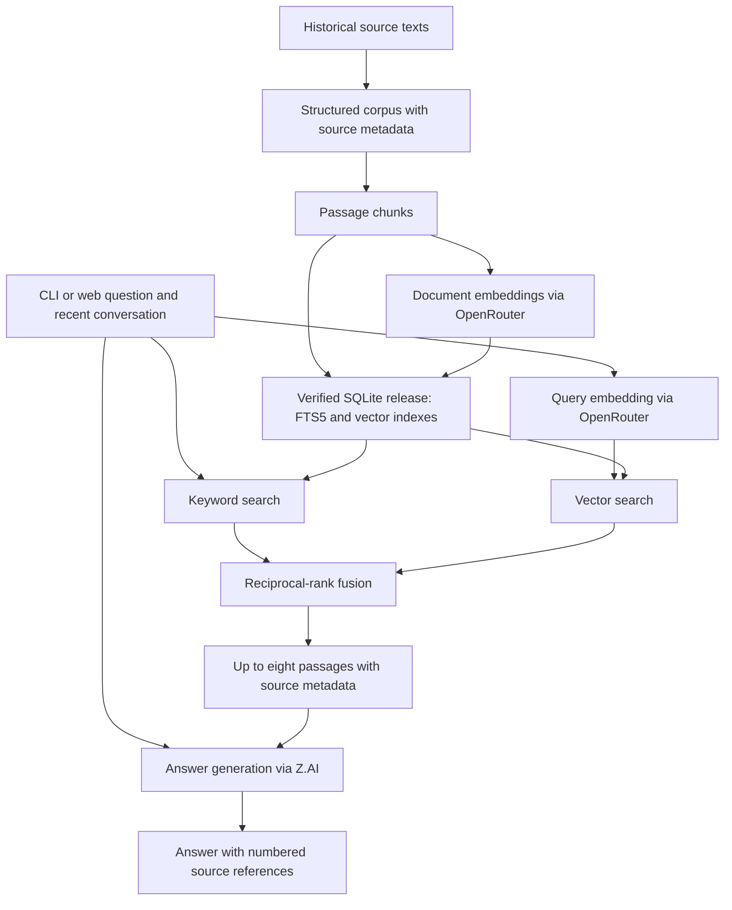

# HomeoRemedica

A Python retrieval-augmented generation (RAG) application for searching historical homoeopathic
literature and generating answers with source citations. It makes **118,259 passages** from
**four books**, covering **1,250 unique remedies**, searchable through a conversational CLI or web app.
The source works are by Allen, Boericke, Clarke, and Kent. Historical reference only; not medical
advice.

The project covers corpus preparation, hybrid search, answer generation, and retrieval evaluation.
Search runs against a local SQLite database; external APIs provide embeddings and generated
answers. The CLI runs directly in Python; the web app uses the same production pipeline through
a FastAPI server.

**Stack:** Python · FastAPI · Uvicorn · React · Vite · TypeScript · SQLite FTS5 · sqlite-vec ·
Pydantic · OpenRouter · Z.AI · pytest · Ruff · Pyright

## Engineering highlights

- **Hybrid retrieval:** combines keyword and vector search through reciprocal-rank fusion, with
  optional filtering by book and up to eight retrieved passages per answer.
- **Structured corpus:** preserves book, remedy, section, and passage metadata across 118,259
  individually embedded passages. See the [dataset guide](dataset/README.md) for source details.
- **Verified corpus releases:** builds immutable SQLite artifacts with manifests and SHA-256
  digests, validates database and index integrity, and verifies releases before activation.
- **Recorded retrieval experiments:** versions query sets and result records, caches embeddings
  and rankings, and compares retrieval strategies through a separate evaluation pipeline.
- **Automated quality checks:** checks package boundaries, builds the Python package, runs linting
  and type checking, and tests against fakes and synthetic artifacts without API keys.

## Architecture

The `production` pipeline builds and searches a versioned local corpus:



OpenRouter provides `qwen/qwen3-embedding-8b` embeddings; Z.AI generates answers with
`glm-5.3-flash` by default.

| Design choice | Engineering benefit |
| --- | --- |
| SQLite with FTS5 and sqlite-vec | Keeps source metadata, keyword search, and vector search in one local database. |
| One passage per chunk | Retains the source passage as the retrieval and citation unit. |
| Reciprocal-rank fusion | Combines keyword and semantic rankings without requiring their raw scores to share a scale. |
| Immutable, verified corpus releases | Records the corpus and embedding configuration used by each release and checks integrity before use. |
| Separate `production` and `experimental` packages | Supports experiments with ranking and embeddings while sharing conversation and answer-generation code. |

## Retrieval results

The experimental retriever evaluates remedy rankings against labeled symptom queries. In the
recorded v8–v9 experiment, adding a symptom-focused instruction to the embedding query improved
validation **Recall@8 by 5.75 percentage points**.

Across all 500 queries, v9 achieved **94.47% candidate recall at a pool size of 640 remedies**.
Candidate recall measures the fraction of labeled target remedies present in that larger ranked
pool, averaged across queries; Recall@8 measures how many reach the first eight results.

| Metric across all 500 queries | v8 | v9 |
| --- | ---: | ---: |
| Candidate recall @ 640 | 94.67% | 94.47% |
| Recall@8 | 20.77% | 24.57% |

Source: recorded [v8 results](benchmarks/results/v8.json) and
[v9 results](benchmarks/results/v9.json), using 4,096-dimensional embeddings.

Recall@8 by query group:

| Query group | Queries | v8 Recall@8 | v9 Recall@8 |
| --- | ---: | ---: | ---: |
| Development | 239 | 21.76% | 23.43% |
| Validation | 261 | 19.86% | 25.61% |
| All queries | 500 | 20.77% | 24.57% |

Recall@8 measures the fraction of labeled target remedies found in the top eight ranked remedies,
averaged across queries. These results describe the `experimental` retrieval strategy,
which uses normalized score fusion and aggregates passage evidence into remedy rankings. Answer
generation and the `production` retriever are outside this measurement.

The comparison uses query dataset v3 and a validation subset that shares no exact symptom text
with the development subset. Validation results were inspected during experimentation, so this is
an exploratory comparison. See the [comparison record](benchmarks/results/v9-comparison.json),
[experiment log](benchmarks/results/v9-experiments.json), and
[benchmark guide](benchmarks/README.md) for settings, scores, and query provenance.

## Quick start

Requirements: Python 3.14 (pinned to 3.14.3), uv `>=0.11.23,<0.12`,
and API keys for OpenRouter and Z.AI. Corpus builds require SQLite 3.53.4 and
`sqlite-vec` 0.1.9, as configured in `corpus.toml`.

Run from the repository root:

```sh
uv sync --locked
cp .env.example .env
```

If your installed uv is outside the supported range, run the pinned version with
`uv tool run --from uv==0.11.23 uv sync --locked`. Use the same
`uv tool run --from uv==0.11.23 uv` prefix in place of `uv` for the commands below.

Set `OPENROUTER_API_KEY` and `ZAI_API_KEY` in `.env`, then build the corpus and start chatting:

```sh
uv run --locked corpus validate
uv run --locked corpus build local-v1
uv run --locked chat
```

The CLI verifies the active corpus at startup. Type a question, use `/books` to list the
available books, `/clear` to reset conversation history, or `/quit` to exit. It prints the
answer and numbered source references. To ask one question and exit, run:

```sh
uv run --locked chat What does Kent say about Nux vomica?
uv run --locked chat --book kent-lectures "What does Kent say about Nux vomica?"
uv run --locked chat --list-books
```

Repeat `--book` to search up to four selected books. Conversation history stays in memory for
the current CLI session.

The source dataset is included; generated SQLite releases are not. Building a release calls
OpenRouter to embed the corpus. Use a unique version for each build; existing releases cannot
be overwritten. To use an existing release instead, set `RAG_CORPUS_DIR` to its parent directory
containing `active.json`.

## Web app

Run the web app from a source checkout; Python distribution artifacts contain the CLI packages.
The web app connects only to `src/production/`. `src/experimental/` remains a separate CLI and
evaluation pipeline. It uses the same settings, book filters, retrieval, answer generation, and
conversation limits as the production CLI. API keys stay on the Python server.

After the Python setup and corpus preparation above, install the frontend with Node.js 22.12+
on a supported even release (Node.js 24 recommended) and npm:

```sh
npm --prefix web ci
```

Run the API from the repository root in one terminal:

```sh
uv run --locked uvicorn api.main:app --reload --host 127.0.0.1 --port 8000
```

Run Vite in another terminal:

```sh
npm --prefix web run dev
```

Open `http://127.0.0.1:5173`. Vite proxies `/api` to Uvicorn on port 8000. Select books to limit
retrieval, send questions, inspect numbered sources, and clear the conversation. Enter sends;
Shift+Enter adds a line. `/books`, `/clear`, `/quit`, and `/exit` also work in the message box.
Conversation history lives in the current browser session's memory and resets on refresh.

To serve the built frontend and API together:

```sh
npm --prefix web run build
uv run --locked uvicorn api.main:app --host 127.0.0.1 --port 8000
```

Open `http://127.0.0.1:8000`. Build the frontend before starting Uvicorn; restart the API after
activating a new corpus release or changing `.env`. `npm --prefix web run preview` also proxies
API requests to port 8000.

The API initializes the verified corpus and provider clients lazily, so setup errors appear in
the app. `GET /api/health` checks the server; `GET /api/books` lists the production books without
requiring provider keys; `POST /api/chat` accepts `message`, `history`, and optional `bookIds`.
Responses include the answer, source citations, corpus/model metadata, and the trimmed history
to send with the next question. Interactive API documentation is at `/docs`.

## Configuration

The production CLI and API read environment variables and optional `.env` and `.env.local` files.

| Variable | Default | Purpose |
| --- | --- | --- |
| `OPENROUTER_API_KEY` | Required | Corpus and query embeddings. |
| `ZAI_API_KEY` | Required for chat | Answer generation. |
| `RAG_CORPUS_DIR` | `artifacts/corpus` | Active pointer and versioned corpus releases. |
| `RAG_MODEL` | `glm-5.3-flash` | Answer model. |
| `RAG_MAX_OUTPUT_TOKENS` | `4096` | Output token limit, from 1 to 4096. |

Each question retrieves up to eight passages from the local corpus and sends the grounded prompt
to Z.AI. OpenRouter supplies query embeddings. The CLI does not need an HTTP server.

## Corpus tooling

`corpus.toml` configures the source data, chunking, embeddings, and release output. The default
pipeline reads `dataset/corpus.json`, treats each passage as one chunk, and builds one shared
SQLite database for all four books.

```sh
# Validate sources and chunking locally; no API key needed.
uv run --locked corpus validate

# Verify and activate an existing release.
uv run --locked corpus activate local-v1
```

Builds write `corpus.sqlite` and `manifest.json` under `artifacts/corpus/<version>/`, then update
`active.json` after verification. Start a new CLI session to load a newly activated release.
Use `build <version> --workers 8` to reduce the default 32 concurrent embedding requests.

## Evaluation

`src/experimental/` owns experimental retrieval, benchmark scoring, and a separate chat CLI.
Retrieval settings live in `evaluation.toml`; query datasets and recorded results live in
`benchmarks/`.

The production CLI remains `chat`; the experimental CLI remains `eval-chat`. Their Python
packages are `production` and `experimental`, respectively.

Before running, change `output.result` in `evaluation.toml` to an unused versioned path such as
`benchmarks/results/v10.json`. The checked-in configuration points to the existing v9 result,
and results cannot be overwritten.

```sh
uv run --locked evaluation
```

Evaluation requires an OpenRouter key and caches embeddings and rankings in `.cache/benchmarks/`.
See the [benchmark records](benchmarks/README.md) for details.

To chat with the experimental retriever, set both `OPENROUTER_API_KEY` and `ZAI_API_KEY`, then run:

```sh
uv run --locked eval-chat
uv run --locked eval-chat --book kent-lectures "What does Kent say about Nux vomica?"
uv run --locked eval-chat --list-books
```

`eval-chat` has the same interactive commands and answer format as `chat`. It reads the `[chat]`
section of `evaluation.toml` for the selected embedding dimension and answer model, alongside
the corpus and retrieval settings. Its first run prepares document embeddings
and a disk-backed search index under the evaluation cache directory; later runs reuse them.
The current dataset has 118,259 chunks, so first-time preparation uses substantial OpenRouter
requests and several gigabytes of local cache space.
The experimental CLI reads the source dataset and does not require an active corpus release.

## Development

```sh
uv sync --locked --all-groups
make check
npm --prefix web ci
make web-check
```

`make check` runs repository boundary checks, a Python build, Ruff, Pyright, and
pytest. Tests use fakes and synthetic artifacts; they do not require API keys or a built corpus.
`make web-check` runs frontend type checking, interaction tests, and the Vite build. `make api`
and `make web` start the two development servers in separate terminals.

- `src/shared/` — conversation contracts, terminal behavior, answer generation, and prompts.
- `src/production/` — production retrieval from an active corpus release.
- `src/production/cli.py` — production terminal chat.
- `api/` — FastAPI interface to the production service and optional built frontend hosting.
- `web/` — minimal React/Vite chat interface.
- `src/experimental/` — experimental retrieval, scoring, and terminal chat.
- `src/corpus/` — source validation, chunking, embeddings, and release tooling.
- `dataset/` — raw texts, processed books, and merged corpus; see the [dataset guide](dataset/README.md).
- `tests/` — Python test suite.

## License

Software and documentation: [MIT](LICENSE). Dataset compilation and processing:
[CC BY 4.0](dataset/LICENSE.md). Underlying historical works retain their applicable rights
and source notices.
