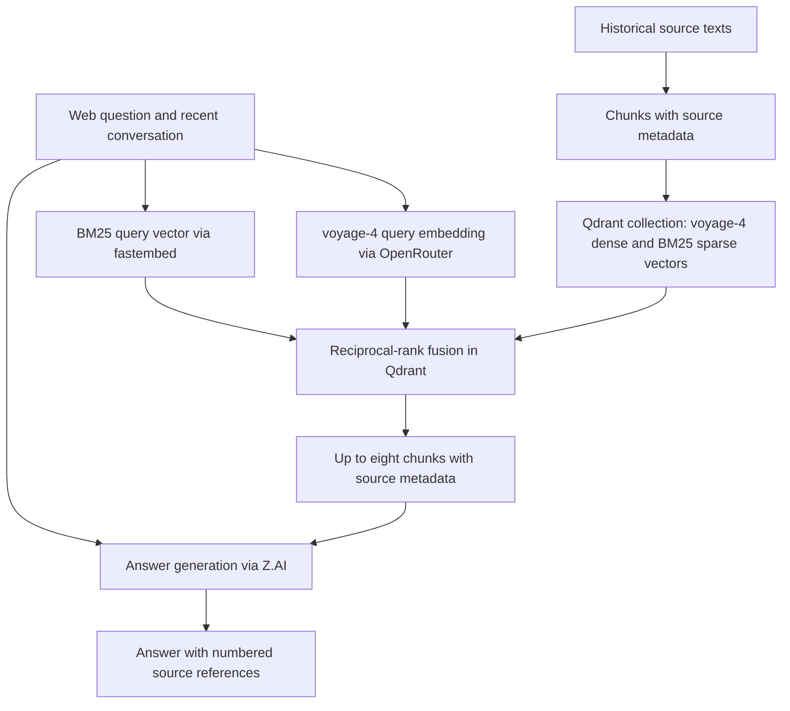

# HomeoRemedica

A Python retrieval-augmented generation (RAG) application for searching historical homoeopathic
literature and generating answers with source citations. It makes **5,846 chunks** from
**four books**, covering **996 unique remedies**, searchable through a conversational web app.
The source works are by Allen, Boericke, Clarke, and Kent. Historical reference only; not medical
advice.

The project covers hybrid search and answer generation. Search runs against a Qdrant collection
built by the HomeoRemedica-dataset repository; external APIs provide query embeddings and
generated answers. A React frontend talks to the production pipeline through a FastAPI server.

**Stack:** Python · FastAPI · Uvicorn · React · Vite · TypeScript · Qdrant · fastembed ·
Pydantic · OpenRouter · Z.AI · pytest · Ruff · Pyright

## Engineering highlights

- **Hybrid retrieval:** fuses BM25 and voyage-4 vector rankings inside Qdrant through
  reciprocal-rank fusion, with optional filtering by book and up to eight retrieved chunks per
  answer.
- **Structured corpus:** preserves book, remedy, and section metadata on every chunk, so
  citations point to their source.
- **Automated quality checks:** checks package boundaries, builds the Python package, runs linting
  and type checking, tests against fakes without API keys, and tests and builds the frontend.

## Architecture

The dataset repository chunks the source texts and indexes them in Qdrant. The `production`
pipeline searches that collection and generates the answer:



OpenRouter provides `voyageai/voyage-4` query embeddings (1024 dimensions); Z.AI generates
answers with `glm-5.3-flash` by default.

| Design choice | Engineering benefit |
| --- | --- |
| Qdrant with named dense and sparse vectors | Keeps source metadata, keyword search, and vector search in one collection. |
| Reciprocal-rank fusion | Combines keyword and semantic rankings without requiring their raw scores to share a scale. |
| Same BM25 model at index and query time | fastembed's `Qdrant/bm25` tokenizes queries exactly as the dataset indexed them. |

## Quick start

Requirements: Python 3.14 (pinned to 3.14.3), uv, make, Node.js 22.12+
on a supported even release (Node.js 24 recommended), npm, a Qdrant cluster holding the
`materia_medica` collection, and API keys for OpenRouter and Z.AI.

Run from the repository root:

```sh
make setup
```

This installs the locked Python and frontend dependencies and creates `.env` from `.env.example`
if it does not already exist. Makefile commands use the pinned uv 0.11.23 automatically for
Python. Direct `uv` commands below require uv `>=0.11.23,<0.12`; if your
installed version is outside that range, replace `uv` with
`uv tool run --from uv==0.11.23 uv`.

Set `QDRANT_URL`, `QDRANT_API_KEY`, `OPENROUTER_API_KEY`, and `ZAI_API_KEY` in `.env`. The
collection is built and updated by `scripts/embed_chunks.py` in the HomeoRemedica-dataset
repository. The first chat request downloads fastembed's small BM25 model to its local cache.

## Web app

Run the web app from a source checkout. API keys stay on the Python server.

After setup above, start the complete web app in one terminal:

```sh
make web
```

Open `http://127.0.0.1:5173`. The command starts Vite and FastAPI together with automatic reload.
Vite forwards `/api` requests to FastAPI on port 8000. Ctrl+C stops both servers; if either
server exits, the other is stopped too. Port 5173 must be available; Vite will report an error
instead of switching to another port. Restart after changing `.env`.
Select books to limit retrieval, send questions, inspect numbered sources, and clear the
conversation. Enter sends; Shift+Enter adds a line. `/books`, `/clear`, `/quit`, and `/exit` also
work in the message box. Conversation history lives in the current browser session's memory
and resets on refresh.

To serve a built frontend and the API from one server:

```sh
npm --prefix web run build
uv run --locked uvicorn api.main:app --host 127.0.0.1 --port 8000
```

Open `http://127.0.0.1:8000`. `make api` remains available for running only the API with automatic
reload. `npm --prefix web run preview` also proxies API requests to port 8000.

The API initializes the Qdrant and provider clients lazily and checks that the collection exists,
so setup errors appear in the app. `GET /api/health` checks the server; `GET /api/books` lists the production books without
requiring provider keys; `POST /api/chat` accepts `message`, `history`, and optional `bookIds`.
Responses include the answer, source citations, corpus/model metadata, and the trimmed history
to send with the next question. Interactive API documentation is at `/docs`.

## Configuration

The API reads environment variables and optional `.env` and `.env.local` files.

| Variable | Default | Purpose |
| --- | --- | --- |
| `QDRANT_URL` | Required for chat | Qdrant cluster URL. |
| `QDRANT_API_KEY` | None | Qdrant API key, required by Qdrant Cloud. |
| `RAG_QDRANT_COLLECTION` | `materia_medica` | Collection to search. |
| `OPENROUTER_API_KEY` | Required for chat | Query embeddings. |
| `ZAI_API_KEY` | Required for chat | Answer generation. |
| `RAG_MODEL` | `glm-5.3-flash` | Answer model. |
| `RAG_MAX_OUTPUT_TOKENS` | `4096` | Output token limit, from 1 to 4096. |

Each question retrieves up to eight chunks from Qdrant and sends the grounded prompt to Z.AI.
OpenRouter supplies query embeddings.

## Development

```sh
make setup
make check
make web-check
```

`make check` validates Python: package building, Ruff linting, Pyright type checking, and pytest.
The test suite includes repository boundary checks, which reject generated artifacts in Git
and keep the chat service independent of the API.
Tests use fakes; they do not require API keys or a Qdrant cluster.
`make web-check` validates the frontend: interaction tests followed by a Vite build, which also
runs TypeScript type checking. `make web` starts Vite and FastAPI together with automatic reload;
`make api` starts only FastAPI.

- `src/shared/` — conversation contracts, chat service, answer generation, and prompts.
- `src/production/` — production retrieval from the Qdrant collection.
- `src/api/` — FastAPI interface to the production service and optional built frontend hosting.
- `web/` — minimal React/Vite chat interface.
- `tests/` — Python test suite.

## License

Software and documentation: [MIT](LICENSE). The dataset is proprietary and not distributed with
this repository. Underlying historical works retain their applicable rights and source notices.
