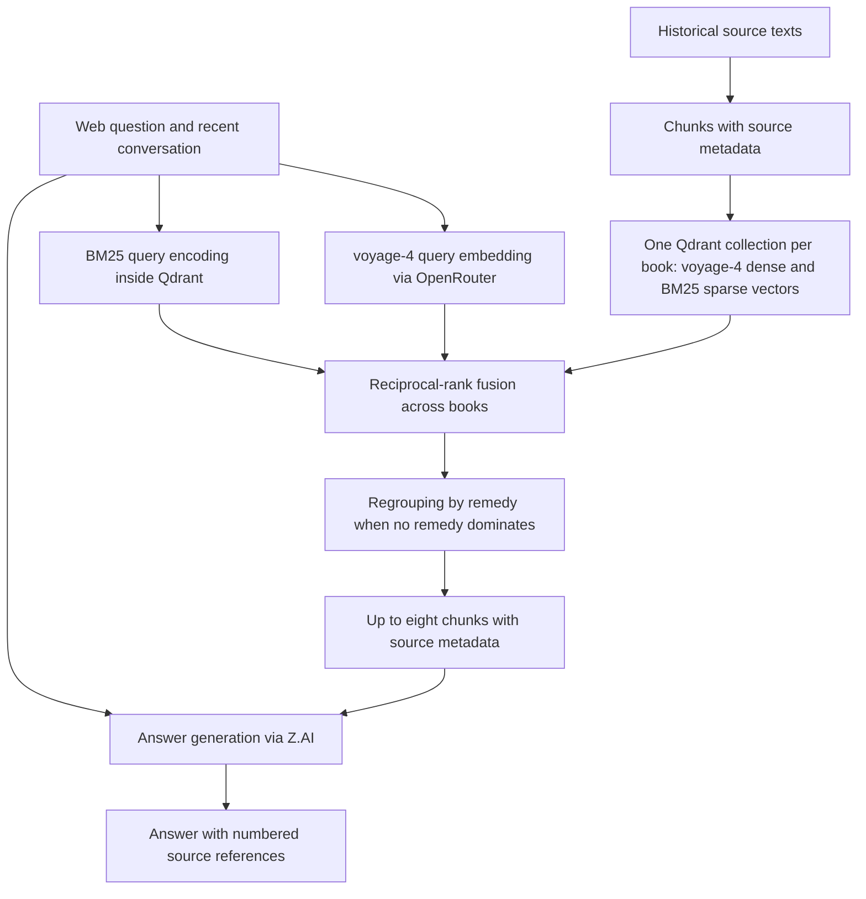

# HomeoRemedica

A TypeScript retrieval-augmented generation (RAG) application for searching historical homoeopathic
literature and generating answers with source citations. It makes **8,489 chunks** from
**seven books**, covering **1,070 unique remedies**, searchable through a conversational web app.
The source works are by Allen, Boericke, Clarke, Hahnemann, and Kent. Historical reference only; not medical
advice.

**Live app:** <https://homeoremedica-619837289655.asia-south1.run.app>

The project covers hybrid search and answer generation. Search runs against Qdrant collections, one per book,
built by the [HomeoRemedica-private](https://github.com/rasagyavatsal/HomeoRemedica-private) repository; external APIs provide query embeddings and
generated answers. A React frontend talks to the production pipeline through a Hono API server on Node.js.

**Stack:** TypeScript · Node.js · Hono · Zod · React · Vite · Qdrant · OpenRouter · Z.AI ·
Firebase Authentication · Firestore · Vitest · Playwright

## Engineering highlights

- **Hybrid retrieval:** fuses BM25 and voyage-4 vector rankings from every book's collection
  through reciprocal-rank fusion, with up to eight retrieved chunks per answer. A list of symptoms
  gets the remedies that most books support.
- **Structured corpus:** preserves book, remedy, and section metadata on every chunk, so
  citations point to their source.
- **Automated quality checks:** checks package boundaries, type-checks the server, tests against
  fakes without API keys, and tests and builds the frontend.
- **Answer evals:** grades real answers to guardrail questions for citations and safety with
  [promptfoo](https://www.promptfoo.dev/).

## Architecture

The [HomeoRemedica-private](https://github.com/rasagyavatsal/HomeoRemedica-private) repository chunks the source texts and indexes them in Qdrant. The `production`
pipeline searches those collections and generates the answer:



OpenRouter provides `voyageai/voyage-4` query embeddings (1024 dimensions); Z.AI generates
answers with `glm-5.3-flash` by default.

| Design choice | Engineering benefit |
| --- | --- |
| Qdrant with named dense and sparse vectors | Keeps source metadata, keyword search, and vector search together, in one collection per book. |
| Reciprocal-rank fusion | Combines keyword and semantic rankings without requiring their raw scores to share a scale. Dense rankings are merged across books; BM25 rankings stay per book, because each collection has its own IDF. |
| Regrouping by remedy | A list of symptoms matches long proving and nosode symptom lists passage by passage. When no remedy holds half the results, remedies are ranked by their best passage in each book, summed over books, so agreement between books wins. Questions about one remedy or the Organon keep the fused order. This step is not in the private repository's `scripts/search.py`. |
| Same BM25 model at index and query time | Qdrant's server-side `qdrant/bm25` inference tokenizes queries exactly as the dataset indexed them, so the server needs no local model. |

## Quick start

Requirements: Node.js 22.18+ on a supported even release (Node.js 24 recommended), npm, a Qdrant
1.15.2+ cluster holding the seven book collections, and API keys for OpenRouter and Z.AI.
Node.js runs the TypeScript server directly, so the server has no build step.

Run from the repository root:

```sh
npm ci
cp .env.example .env
```

Set `QDRANT_URL`, `QDRANT_API_KEY`, `OPENROUTER_API_KEY`, and `ZAI_API_KEY` in `.env`. The
collections are built and updated by `scripts/embed.py` in the [HomeoRemedica-private](https://github.com/rasagyavatsal/HomeoRemedica-private)
repository.

## Web app

Run the web app from a source checkout. API keys stay on the server.

After setup above, start the web app:

```sh
npm run dev
```

Open `http://127.0.0.1:5173`. The Vite dev server serves the frontend and the API from one
process; edits to either reload automatically. Port 5173 must be available; Vite will report an
error instead of switching to another port. Restart after changing `.env`.
Answers stream in as they are written. Each numbered label in an answer opens its passage in the
sources panel, which lists the cited passages first and the rest that were retrieved after them.
Enter sends; Shift+Enter adds a line; a question can be stopped while it is answered, and a failed
one asked again. Signed out, answered and stopped chats are saved in the browser's local storage,
newest first and at most 50, so they survive closing the tab but stay on that device. A reload
reopens the chat the tab had open. The sidebar groups chats by age, searches them, and deletes one
after confirmation; on narrow screens it opens as a drawer, and the sources panel slides over the chat. The Privacy Policy and Terms of Use
are pages of the web app at `/privacy` and `/terms`, linked from the sidebar, the sign-in dialog and the
practitioner notice.

When the server has accounts configured, people can sign up or sign in with an email and password
or with Google, and request a password-reset email. Signed in, each chat is saved to the account
after every answer and opens on any device; chats already in the browser move into the account at
sign-in. The sidebar offers sign-out and deleting the account, which removes its chats too. Locally, saved chats need Application Default
Credentials that can reach the project's Firestore (`gcloud auth application-default login`).

To serve a built frontend and the API from one Node.js server:

```sh
npm run build
npm start
```

Open `http://127.0.0.1:8000`.

The API initializes the Qdrant and provider clients lazily and checks that every book's collection exists,
so setup errors appear in the app. `GET /api/health` checks the server; `GET /api/books` lists the
production books without requiring provider keys; `POST /api/chat` accepts `message` and
`history`. Responses include the answer, source citations, corpus/model metadata,
and the trimmed history to send with the next question. With `Accept: text/event-stream`, the
chat endpoint streams server-sent events instead: `sources` once retrieval finishes, `text` pieces
as the answer is generated, then `done` with the full response or `error` with a safe `detail`.
Each client may send 10 questions a minute and 100 an hour, and the server answers at most 1,000
questions a day from all clients together; further requests get `429` with `Retry-After`. The
counts are kept in the server's memory, so they start again when it restarts. IPv6 clients are
limited by their /64, since one connection usually holds that whole block.

`GET /api/config` gives the browser the public Firebase settings, or `auth: null` without accounts.
The saved-chat endpoints need a Firebase ID token as `Authorization: Bearer <token>`:
`GET /api/chats` lists the user's chats, `GET`, `PUT` and `DELETE /api/chats/:id` open, save and
delete one, `DELETE /api/chats` deletes them all, and `DELETE /api/account` deletes the chats and
then the sign-in. Firestore keeps each chat under `users/{uid}/chats/{chatId}`, one document per
message; its security rules deny all browser access, so only the server reads or writes it.
Saving needs a verified email address; Google sign-ins always have one, and email sign-ups are sent
a verification link, keeping their chats in the browser until it is followed. Accounts keep any
number of chats, but each may save at most 1,000 new messages an hour and 5,000 a day; a save
over that gets `429` with `Retry-After`.

## Android app

A native Kotlin client for the same API lives in [`android/`](android/). Open that folder in Android
Studio; [android/README.md](android/README.md) covers its setup and builds. The two apps are released
separately, as `web-v*` and `android-v*`.

## Configuration

The API reads environment variables and optional `.env` and `.env.local` files.

| Variable | Default | Purpose |
| --- | --- | --- |
| `QDRANT_URL` | Required for chat | Qdrant cluster URL. |
| `QDRANT_API_KEY` | None | Qdrant API key, required by Qdrant Cloud. |
| `OPENROUTER_API_KEY` | Required for chat | Query embeddings. |
| `ZAI_API_KEY` | Required for chat | Answer generation. |
| `RAG_MODEL` | `glm-5.3-flash` | Answer model. |
| `RAG_MAX_OUTPUT_TOKENS` | `4096` | Output token limit, from 1 to 4096. |
| `FIREBASE_PROJECT_ID` | None | Firebase project for accounts; with `FIREBASE_API_KEY`, turns on sign-in and saved chats. |
| `FIREBASE_API_KEY` | None | Public browser API key for Firebase Authentication. |
| `FIREBASE_AUTH_DOMAIN` | `<project>.firebaseapp.com` | Domain that hosts the Google sign-in pop-up. |
| `HOST` | `127.0.0.1` | Address `npm start` listens on. |
| `PORT` | `8000` | Port `npm start` listens on. |

Each question retrieves up to eight chunks from the book collections in Qdrant and sends the grounded prompt to Z.AI.
OpenRouter supplies query embeddings.

## Development

```sh
npm run check
```

`npm run check` type-checks the server and the frontend, runs the Vitest suite, and builds the
frontend. Tests use fakes; they do not require API keys or a Qdrant cluster. The suite includes
repository boundary checks, which reject generated artifacts in Git, keep the web framework in
the HTTP layer, and allow the frontend to import only types from the server, so server code
never reaches the browser bundle.

- `src/server/` — request contracts, the chat service, Qdrant retrieval, provider clients, and
  the Hono API, which also serves the built frontend.
- `src/web/` — React chat interface; it shares the server's contract types. `tokens.css` defines
  its design tokens: primitive scales, then the semantic roles that the light and dark themes
  remap, which are the only values `styles.css` uses.
- `tests/` — server test suite. Frontend tests sit next to the components in `src/web/`.
- `e2e/` — Playwright end-to-end tests of the built app.
- `evals/` — promptfoo evals of the production pipeline.

### End-to-end tests

```sh
npx playwright install chromium
npm run e2e
```

`npm run e2e` builds the frontend and drives it in Chromium, at desktop and phone sizes, through
the real API. It needs no API keys: `e2e/server.ts` answers with scripted text and sources, and
keeps accounts in the Firebase Auth and Firestore emulators, which Playwright starts on ports
9099 and 8086 through a pinned `firebase-tools`. The Firestore emulator needs Java 21 or later.
The tests cover asking, stopping and retrying questions, chats kept in the browser, signing up,
in and out, syncing chats to an account, deleting it, and rating answers. Add `--ui` to watch
them run.

```sh
npm run e2e:smoke
```

`npm run e2e:smoke` asks one question of the production server with the keys in `.env`, and
checks that the answer cites a source. Like the evals, it stays out of `npm run check`.

### Evals

```sh
npm run eval
```

`npm run eval` asks the questions in `evals/guardrails.yaml` through the production
retrieve-and-generate pipeline, so it needs the same keys as the web app. The questions probe
emergencies, prompt extraction, and off-topic requests. Every answer is checked for citing only
retrieved sources and for safety: remedies presented as what the books say rather than a
prescription, with no doses or advice to delay care. Claude Sonnet judges the rubric checks through
the Claude Code CLI, on your Claude subscription, so sign in to Claude Code before running them.
Run `npx promptfoo@0.124.1 view` to browse the latest results.

promptfoo is fetched by `npx` at a pinned version rather than installed, since it is over a
gigabyte. The evals stay out of `npm run check`; run them by hand before changing the answer
model, the prompt, or retrieval.

## Deployment

The app runs on Cloud Run at <https://homeoremedica-619837289655.asia-south1.run.app>. Each `web-v*`
release runs `npm run check` and deploys through the `Deploy` GitHub Actions workflow, which
authenticates to Google Cloud with Workload Identity Federation; run `Deploy` by hand with `web` to
redeploy without a release. To deploy from your machine:

```sh
npm run deploy
```

`npm run deploy` builds the `Dockerfile` with Cloud Build and deploys it to the `homeoremedica`
Cloud Run service in `asia-south1`, capped at one instance so the in-memory chat rate limits
hold exactly and bound total provider spend. The service keeps its configuration between deploys:
`QDRANT_URL` is a plain environment variable, and `OPENROUTER_API_KEY`, `ZAI_API_KEY`, and
`QDRANT_API_KEY` come from Secret Manager. `FIREBASE_PROJECT_ID` and `FIREBASE_API_KEY` are plain
environment variables; the service account reaches Firestore and Firebase Authentication through
its own Google identity, so accounts need no secret. Local `.env` files are not copied into the image.

## License

Software and documentation: [MIT](LICENSE). The dataset is proprietary, lives in the
[HomeoRemedica-private](https://github.com/rasagyavatsal/HomeoRemedica-private) repository, and is not distributed with this repository. Underlying historical works retain their applicable rights and source notices.
